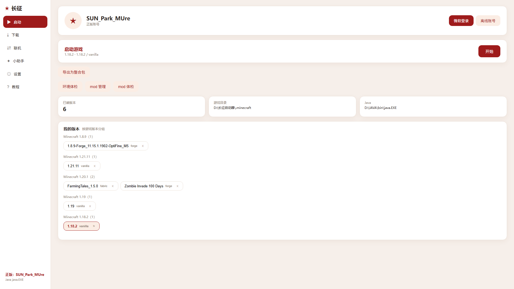
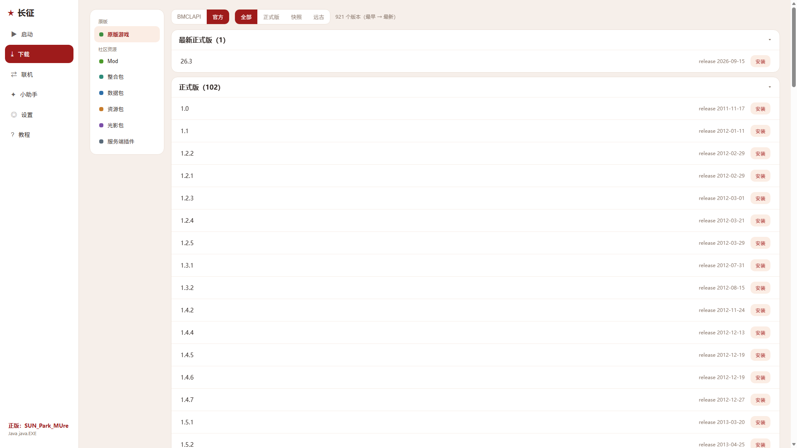
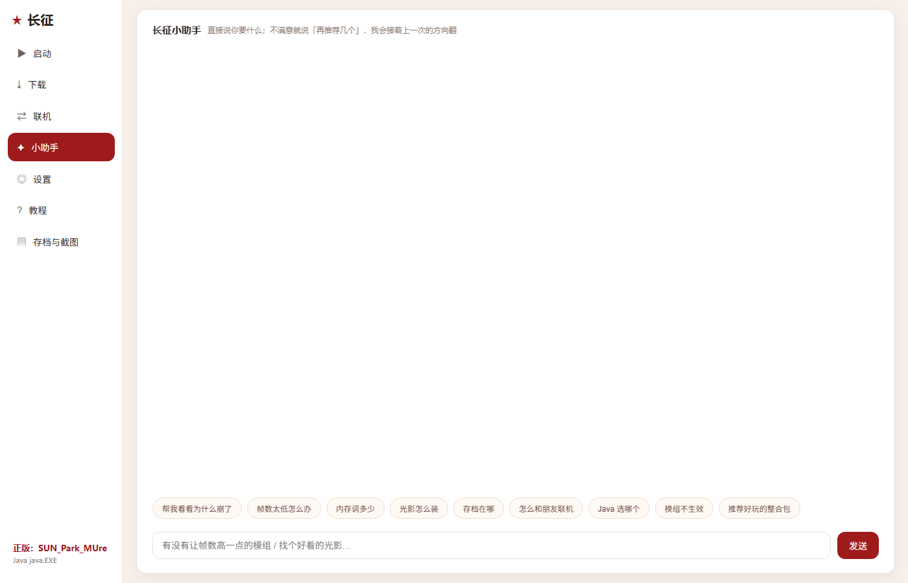

# 长征启动器

一个能自己修自己的 Minecraft 启动器。Python 后端 + 本地网页界面 + Electron 外壳，长得像桌面软件，不是浏览器标签页。



## 下载

去 [Releases](https://github.com/parkdug/changzheng-launcher/releases) 下最新版，解压就能用，不用装 Python。

> 想从源码跑：`pip install certifi pillow`，然后 `python backend.py`，浏览器开 `http://127.0.0.1:8765`。

## 它和别的启动器不一样的地方

**小助手会干活，不只是搜索。**
说「有没有让帧数高一点的模组」，它按意思去搜；说「再推荐几个」，它接着上一批翻；说「帮我导入这个整合包」，它直接导；说「把当前版本导出成整合包」，它直接打包。闪退了点「帮我看看为什么崩了」，它读日志判断原因，重复的 mod 自己挪走、缺的前置自己补上、内存不够告诉你要调多少。

**模组名是中文的。**
先查 MC百科，查不到按词表拼，最后走机翻兜底；列表里中文在上、英文原名在下。

**拖进来就能用。**
文件拖到小助手页面，松手就传上去，然后一句话让它处理。



## 功能

| | |
|---|---|
| 版本 | 2009 年远古版到最新正式版，Forge / Fabric / NeoForge / OptiFine，按版本隔离启动 |
| 下载 | 原版分组列出；模组、光影、资源包、整合包直接给热门榜，也能搜 |
| 联机 | 三步开服（生成配置 / 下服务端 / 开服），可切正版校验 |
| 整合包 | 导出当前版本（可选带不带游戏设置、启动器设置），导入 zip / mrpack |
| 体检 | Java、内存、磁盘、权限、网络一次查完；mod 多选批量启停、排序、搜索 |
| 存档与截图 | 存档跟版本隔离，截图汇总所有位置按月分组 |
| 更新 | 填一个 `version.json` 地址就能检查更新 |



## 常见问题

**启动没反应 / 闪退**
先点小助手里的「帮我看看为什么崩了」，八成是内存或前置问题。

**Java 版本怎么选**
1.16 及以下 Java 8，1.17–1.20 Java 17，1.20.5 以上 Java 21。路径填在「设置 → 其他」。

**游戏目录在哪**
默认是启动器旁边的 `.minecraft`；没有就用你用户目录下的。启动页信息卡会显示实际位置。

**模组装了不生效**
先确认加载器对不对（Fabric 的 mod 不能扔进 Forge），再确认装进了当前版本的 `mods`。

**和朋友联机**
局域网直连「内网IP:25565」；外网需要把 25565 映射出去（frp / playit 之类）。

## 从源码构建

```bash
pip install certifi pillow pyinstaller

# 后端（含界面）
pyinstaller --onefile --windowed --name 长征引擎 --add-data "web;web" --runtime-tmpdir run backend.py

# 外壳
cd electron && npm install
npx electron .
```

## 说明

个人业余项目，代码全部开源（MIT）。游戏本体、模组、光影的版权归各自作者，本仓库不含任何游戏文件。
